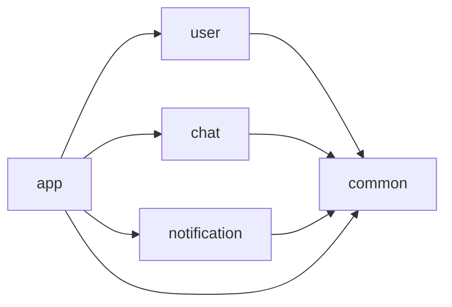
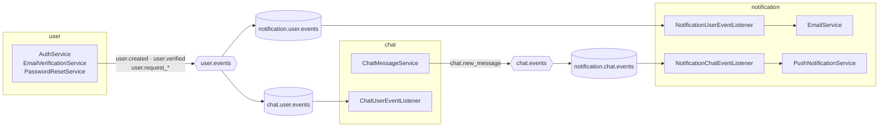
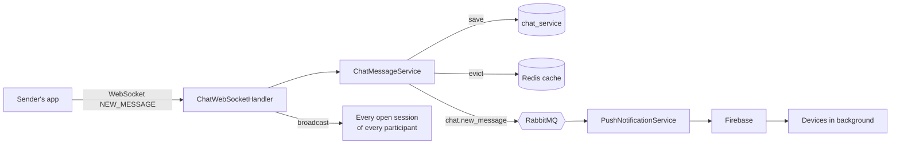

# Chat app backend

**The backend of a real-time chat app, built with Kotlin and Spring Boot.** Sign up, verify your email, find people by
username or email, and start a one-to-one or group chat. Messages arrive instantly over a WebSocket, and as a push
notification on Android and iOS when the app is in the background.

It's a learning project, built to look like an **industry-level** Kotlin backend: some parts may seem overkill for an
app this size, and that's on purpose. It's a **modular monolith**: one deployable app, split into feature modules that
each own their database schema and only talk to each other through events on a message broker.


## Try it

The backend isn't deployed publicly. Run it locally: see [Run it locally](#run-it-locally). It needs a Supabase project
(its PostgreSQL database, and its Storage for profile pictures), a RabbitMQ broker, a Redis instance, an SMTP server
and a Firebase project (for push notifications).

## Features

- **Sign up & sign in** with email, username and password. Usernames are 3 to 20 characters; passwords at least 8,
  with a digit or a special character. Passwords are hashed with bcrypt.
- **Email verification:** a new account gets an HTML email with a verification link (valid 24 hours). You can't sign in
  until it's verified, and you can ask for a new link.
- **Forgot & change password:** a reset link by email (valid 30 minutes), or a change from inside the app with the old
  password. Both revoke all your refresh tokens, so every device has to sign in again. Asking for a reset with an
  unknown email answers the same as with a known one, so this endpoint doesn't reveal who has an account.
- **Short-lived access tokens, rotating refresh tokens:** a JWT access token (15 minutes in production) and a refresh
  token valid 30 days. Each refresh gives a new pair and invalidates the old refresh token; signing out revokes it.
- **Rate limiting:** sign-up, sign-in, refresh, forgot-password and resend-verification are limited to 10 requests per
  hour per IP (`429 Too Many Requests` beyond). Resending a verification email also backs off per address: 1 minute,
  then 5 minutes, then 1 hour.
- **Find people** by exact username or email, case-insensitive.
- **One-to-one and group chats:** create a chat with one or more people, add participants later, or leave. A chat
  whose last participant leaves is deleted.
- **Chat list,** most recently active first, each with its participants and last message.
- **Message history,** paginated by date (`before` + `pageSize`, 20 by default), so a client can scroll back as far as
  it needs.
- **Real-time messaging over WebSocket:** send a message and every open session of every participant receives it, on
  every device. Deleting a message, someone joining or leaving, or a profile picture change are pushed live too.
- **Delete your own messages** (and only your own).
- **Profile pictures:** the app uploads the image straight to Supabase Storage with a signed URL, then confirms it. JPEG,
  PNG and WebP only; the old picture is deleted from storage when replaced.
- **Push notifications** with Firebase Cloud Messaging for every new message, to every device of every participant but
  the sender. On iOS, they're grouped in one thread per chat; on Android, those waiting for an offline device collapse
  into one per chat.
- **Retries for failed pushes:** a device that couldn't be reached for a temporary reason is retried after 30 s, 1 min,
  2 min, 5 min and 10 min; a device token that's no longer valid is removed.

## Tech stack

| Area             | Choice                                                  | Why                                                                                     |
| ---------------- | ------------------------------------------------------- | --------------------------------------------------------------------------------------- |
| Language         | Kotlin 2.2 on JDK 21                                    | Null safety, data and sealed classes, concise Spring code                               |
| Framework        | Spring Boot 4 (Spring MVC, Spring Security)             | The industry standard for JVM backends, with everything below as starters               |
| Architecture     | Modular monolith, one Gradle module per feature         | Clear boundaries between features, one app to run and deploy                            |
| Build            | Gradle convention plugins (`build-logic`), version catalog | Each module's build file is a few lines; versions and config live in one place       |
| Database         | PostgreSQL (hosted on Supabase), Spring Data JPA, Hibernate | Relational data with typed repositories; one schema per module                     |
| Messaging        | RabbitMQ (Spring AMQP), topic exchanges                 | Modules react to each other's events without depending on each other's code            |
| Real time        | Spring WebSocket                                        | One persistent connection per device for messages and live updates                     |
| Cache & limits   | Redis (Spring Data Redis, Lua scripts)                  | Fast shared state for the message cache and atomic rate-limit counters                  |
| Auth             | JWT (jjwt, HS256), bcrypt                               | Stateless auth that scales; refresh tokens stored hashed so a leaked table is useless   |
| Email            | Spring Mail (Mailgun SMTP) + Thymeleaf templates        | HTML emails built from reusable layouts and fragments                                   |
| File storage     | Supabase Storage (signed upload URLs)                   | Images go straight from the app to storage, never through the backend                   |
| Push             | Firebase Admin SDK (FCM, with APNs config for iOS)      | One API for Android and iOS notifications                                               |
| Serialization    | Jackson 3 + Kotlin module                               | JSON for the REST API, the WebSocket, RabbitMQ events and the Redis cache               |

## Architecture

The project is split into **5 Gradle modules** plus the build logic. `app` is the only Spring Boot application; it pulls
in the feature modules and wires security and caching. Each feature module has the same layers: `api` (controllers,
DTOs, error handling), `domain` (models, exceptions, events), `service` (business rules) and `infra` (database,
messaging, external services).

```
app/                    ChatApplication, security filter chain, Redis cache config, application*.yml
common/                 Shared types (UserId, ChatId…), events, RabbitMQ config, JwtService, base error handling
user/                   Accounts, auth, email verification, password reset, rate limiting  → schema user_service
chat/                   Chats, participants, messages, WebSocket, profile pictures         → schema chat_service
notification/           Emails, device tokens, push notifications                          → schema notification_service
build-logic/            Gradle convention plugins shared by every module
```



**Feature modules never depend on each other.** They only share `common`, and anything one of them needs to know about
another arrives as an event through RabbitMQ:



For example, when a user verifies their email, `user` publishes `user.verified`; `chat` receives it and creates its own
copy of that user as a **chat participant**. From then on, `chat` never reads the `user_service` tables.

How a message travels:



## API

All endpoints are under `/api`. Everything except `/api/auth/**` needs an `Authorization: Bearer <access token>` header
(`/api/auth/change-password` needs it too). Errors come back with the matching status: `400` invalid input, `401`
invalid credentials or token, `403` email not verified or not allowed, `404` not found, `409` already exists or same
password, `429` rate limited.

| Method | Path                                         | What it does                                                   |
| ------ | -------------------------------------------- | -------------------------------------------------------------- |
| POST   | `/api/auth/register`                         | Creates an account and sends the verification email            |
| POST   | `/api/auth/login`                            | Returns the user with an access and a refresh token            |
| POST   | `/api/auth/refresh`                          | Swaps a refresh token for a new pair                           |
| POST   | `/api/auth/logout`                           | Revokes a refresh token                                        |
| GET    | `/api/auth/verify?token=`                    | Verifies an email address                                      |
| POST   | `/api/auth/resend-verification`              | Sends a new verification email                                 |
| POST   | `/api/auth/forgot-password`                  | Sends a password reset email                                   |
| POST   | `/api/auth/reset-password`                   | Sets a new password with a reset token                         |
| POST   | `/api/auth/change-password`                  | Changes the password of the signed-in user                     |
| GET    | `/api/chat`                                  | Chats of the signed-in user, most recent first                 |
| POST   | `/api/chat`                                  | Creates a chat with other users                                |
| GET    | `/api/chat/{chatId}`                         | One chat, with its participants and last message               |
| GET    | `/api/chat/{chatId}/messages?before=&pageSize=` | A page of messages, oldest first                            |
| POST   | `/api/chat/{chatId}/add`                     | Adds participants to a chat                                    |
| DELETE | `/api/chat/{chatId}/leave`                   | Leaves a chat                                                  |
| DELETE | `/api/messages/{messageId}`                  | Deletes one of your messages                                   |
| GET    | `/api/chat/participants?query=`              | Finds a user by username or email (yourself without `query`)  |
| POST   | `/api/chat/participants/profile-picture-upload?mimeType=` | Returns a signed URL to upload a profile picture  |
| POST   | `/api/chat/participants/confirm-profile-picture` | Saves the uploaded picture as your profile picture         |
| DELETE | `/api/chat/participants/profile-picture`     | Removes your profile picture                                   |
| POST   | `/api/notification/register`                 | Registers a device for push notifications (`ANDROID` / `IOS`)  |
| DELETE | `/api/notification/{token}`                  | Unregisters a device                                           |

### WebSocket

Connect to `/ws/chat` with the same `Authorization: Bearer <access token>` header on the handshake. Every frame is a
JSON envelope with a `type` and a `payload` (itself a JSON string):

```json
{ "type": "NEW_MESSAGE", "payload": "{\"chatId\":\"…\",\"content\":\"Hi!\",\"messageId\":\"…\"}" }
```

| Direction       | Type                        | When                                                          |
| --------------- | --------------------------- | ------------------------------------------------------------- |
| Client → server | `NEW_MESSAGE`               | Send a message (`messageId` is optional, a UUID made by the app) |
| Server → client | `NEW_MESSAGE`               | A message was sent in one of your chats                       |
| Server → client | `MESSAGE_DELETED`           | A message was deleted                                         |
| Server → client | `CHAT_PARTICIPANTS_CHANGED` | Someone joined or left a chat; fetch it again                 |
| Server → client | `PROFILE_PICTURE_UPDATED`   | Someone in your chats changed their picture                   |
| Server → client | `ERROR`                     | A frame couldn't be read (`INVALID_JSON`)                     |

The server pings every 30 seconds and closes a connection that hasn't answered for 60 seconds.

## Decisions & trade-offs

- **A modular monolith rather than microservices.** Each feature is a Gradle module with its own Postgres schema and
  talks to the others through RabbitMQ only, so any of them could become its own service later, with no code to
  untangle. Until then, there's one app to run, deploy and debug.
- **Events after commit.** Inside the `chat` module, WebSocket broadcasts listen to Spring events with
  `@TransactionalEventListener(AFTER_COMMIT)`: clients are only told about a change once it's really in the database.
- **Data duplicated on purpose.** `chat` keeps its own `chat_participants` table (username, email, picture), filled
  from `user.verified` events. Reading chats never needs the `user` module, at the cost of keeping a copy in sync.
- **Message IDs can come from the app.** A client can send its own UUID with a message, so it can show the message
  straight away and match it with the server's copy when it comes back.
- **The first page of each chat cached in Redis.** The most requested page (latest messages, no `before`) is cached for
  30 minutes and evicted whenever a message is sent or deleted in that chat. Older pages always come from Postgres.
- **The last message of every chat in one query.** The chat list loads each chat's latest message with a single
  query over all chat IDs, instead of one query per chat.
- **Atomic rate limits with Lua.** Counting and setting the expiry run in one Redis script, so two requests at the same
  time can't both slip under the limit. Limits are declared on the endpoint itself with an `@IpRateLimit` annotation,
  read by an MVC interceptor.
- **Trusting proxies explicitly.** The client IP is read from `X-Real-IP` only when the request comes from a known
  nginx address; in production, a rate-limited request that doesn't come through the proxy is refused, so the header
  can't be spoofed to dodge the limits.
- **Refresh tokens stored as hashes.** Only a SHA-256 of each refresh token is stored, and it's deleted on use. A stolen
  database dump can't be used to sign in, and a refresh token can't be replayed.
- **Signed uploads for pictures.** The backend hands out a 5-minute upload URL and the app sends the image straight to
  Supabase Storage, so large files never go through the API. The confirmed URL must point to the project's own storage.
- **Classifying push failures.** Firebase errors are split into permanent (the token is deleted) and temporary
  (retried with a growing delay). The retry queue lives in memory: simple, but retries pending during a restart are
  lost.
- **WebSocket sessions tracked in memory.** Maps of sessions per user and per chat, guarded by a read-write lock, so a
  broadcast only reaches the sessions of that chat. It works for one instance; several instances would need a shared
  broker (for example Redis pub/sub) between them.
- **Two configuration profiles.** `dev` relaxes the rules (long-lived access tokens, no rate limits, no proxy, DB schema
  updated by Hibernate); `prod` tightens them (15-minute tokens, rate limits, proxy required, schema only validated).

## Possible evolutions

Directions the project could take:

- **Tests:** unit tests for the services (auth, token rotation, chat rules), the rate limiters, and the push retry logic;
  integration tests with **Testcontainers** for Postgres, RabbitMQ and Redis; WebSocket tests for the broadcast rules.
  Today there's only a `contextLoads` test.
- **CI** with GitHub Actions: build and tests on every pull request.
- **Database migrations** with Flyway or Liquibase instead of Hibernate's `ddl-auto`.
- **Docker Compose** for Postgres, RabbitMQ, Redis and Mailpit, so the project runs locally without any cloud account.
- **API documentation** with OpenAPI / Swagger UI.
- **Several instances:** share WebSocket broadcasts through Redis pub/sub, and keep the push retry queue in RabbitMQ
  (delayed messages) rather than in memory.
- **More chat features:** read receipts, typing indicators, editing messages, attachments.
- **Observability:** Actuator health checks, metrics and structured logs.

## Run it locally

Requirements: JDK 21, and access to a Supabase project (PostgreSQL + Storage), RabbitMQ, Redis, an SMTP server and a
Firebase project.

```bash
git clone https://github.com/Vincicent/Chat_app_backend.git
cd Chat_app_backend
```

**1. Secrets.** Set these environment variables (`application.yml` reads them):

```bash
export POSTGRES_PASSWORD=...
export REDIS_PASSWORD=...
export RABBITMQ_PASSWORD=...
export MAILGUN_PASSWORD=...
export SUPABASE_SERVICE_KEY=...
export JWT_SECRET=...   # a Base64 key of at least 32 bytes, e.g. from: openssl rand -base64 32
```

**2. Firebase.** Download a service account key from the Firebase console (*Project settings → Service accounts*) and
save it as `app/src/main/resources/firebase-credentials/chatapp-firebase-adminsdk.json`. That folder is git-ignored.

**3. Your own services.** Hosts and usernames in `app/src/main/resources/application.yml` point to the author's
instances. Change them there, or override them with environment variables (for example `SPRING_DATASOURCE_URL`,
`SPRING_DATA_REDIS_HOST`, `SPRING_RABBITMQ_HOST`, `SUPABASE_URL`). In Postgres, create the three schemas
`user_service`, `chat_service` and `notification_service`; with the `dev` profile, Hibernate creates the tables. In
Supabase Storage, create a public bucket named `profile-pictures`.

**4. Run** with the `dev` profile (a profile is required: some settings only exist in `application-dev.yml` and
`application-prod.yml`):

```bash
./gradlew :app:bootRun --args='--spring.profiles.active=dev'
```

The API is then on `http://localhost:8080`, and the WebSocket on `ws://localhost:8080/ws/chat`.

| Command                                                    | What it does                                  |
| ---------------------------------------------------------- | --------------------------------------------- |
| `./gradlew :app:bootRun --args='--spring.profiles.active=dev'` | Runs the backend with the dev settings    |
| `./gradlew build`                                          | Compiles every module and runs the tests      |
| `./gradlew :app:bootJar`                                   | Builds a runnable jar in `app/build/libs`     |

## Credits

- Built while following [Philipp Lackner](https://github.com/philipplackner)'s Kotlin Multiplatform chat app course.

## Author

Built by [**Vincicent**](https://github.com/Vincicent) to learn and demonstrate a production-style Kotlin backend:
modular, event-driven, with real-time messaging, push notifications and the security a public API needs.
